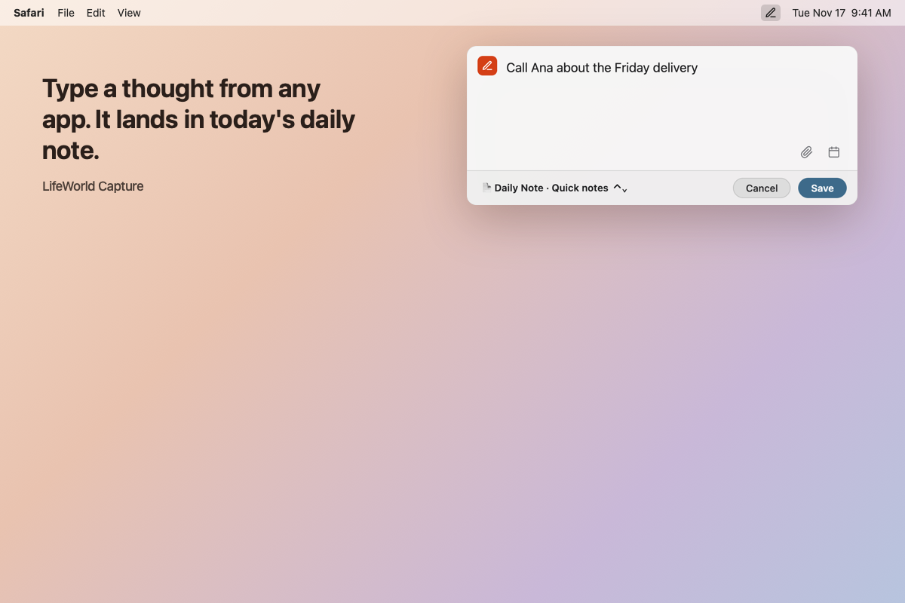
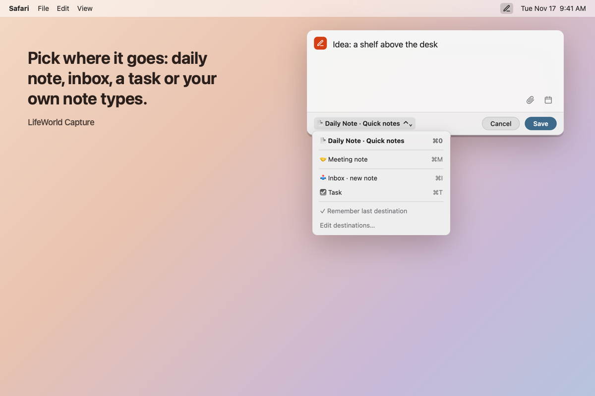
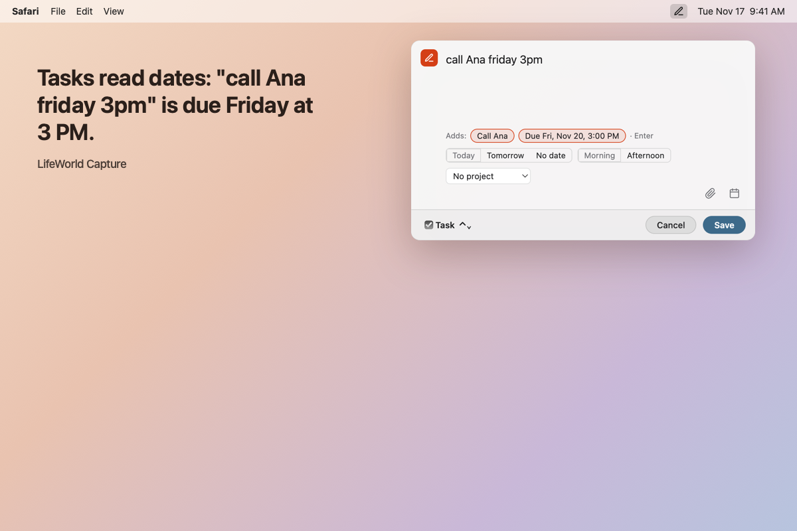

# LifeWorld Capture

A pen icon in your computer's menu bar. Click it, type a thought, press Return, and it is saved in your vault while you stay in the app you were using.

## Getting started

1. In Obsidian, open Settings, Community plugins, Browse, and search for "LifeWorld Capture". Install it and turn it on.
2. A pen icon appears in your menu bar. Click it to open the capture box.
3. Type, then press Return (or click Save). The box shows "saved" and stays open for the next thought. Press Escape to close it.

LifeWorld Capture works while Obsidian is open, minimized included. When you quit Obsidian the icon goes away until you open it again.

## Where a capture goes

The destination is at the bottom left of the box. Click it to pick another one, or press its key while you type.

| Destination | Key | What it writes |
|---|---|---|
| Daily Note | ⌘0 | A line with the time under "Quick notes" in today's daily note |
| Inbox | ⌘I | A new note in your inbox folder; the first line is its title |
| Task | ⌘T | A task (see below) |
| Your own types | your key | A new note in a folder, or a line under a heading in the daily note |

The daily note is found and made with Obsidian's own Daily notes settings (folder, name and template). To file a Daily Note capture on another day, click the calendar button and pick the day.

## Tasks

With LifeWorld installed, a Task capture is a real task note. It shows on LifeWorld's Today page and in the Planner. Words in the first line set the Due property: "call Ana friday 3pm" is due Friday at 3:00 PM. The "Adds:" line shows what will be saved before you press Return. With no date typed, the Today, Tomorrow and No date buttons and the Morning and Afternoon buttons decide, and you can pick a project.

Without LifeWorld, a task is a `- [ ]` line at the end of one task list note (Tasks plugin format, `Tasks.md` to start with).

## Pictures

Paste a picture, drop one on the box, or click the paperclip. It is saved in your vault and linked in the capture. Daily Note, heading and task pictures go to the folder set under Settings, Attachments; a new note keeps its pictures in its own folder.

## Settings

Open Settings, LifeWorld Capture. It has five tabs.

- **General:** show or hide the menu bar icon; record a shortcut; remember the last destination; the inbox folder and any properties a new inbox note gets.
- **Daily Note:** change the daily note folder, name or template only if you want something other than Obsidian's Daily notes settings; the heading captures go under; time stamp on or off; newest on top.
- **Destinations:** add your own note types. Each has an icon, a name, where it goes (a new note in a folder, or a heading in the daily note), an optional tag, an optional key, and optional properties or a template note. Move them up and down to set the order in the picker.
- **Tasks:** where tasks go, and the defaults for new tasks.
- **Attachments:** the picture folder, and whether the picture is linked in the capture.

## A shortcut from any app

No shortcut is set when you install it. Go to Settings, LifeWorld Capture, General, Global shortcut, click Record and press the keys you want, for example Control, Option, Command and N together. If another app already uses those keys, the setting says so; pick other keys. The menu bar icon keeps working either way.

## Good to know

- Computers only. Made and tested on the Mac; Windows and Linux are untested. Phones have no menu bar, so it does not load there.
- The icon and the shortcut use a part of Obsidian's desktop app that plugins are not officially offered. If a future Obsidian removes it, you see one message, the icon does not appear, and nothing else is affected.
- Nothing is sent anywhere. The capture box is a small local page with no links and no remote content.
- If a task says "LifeWorld is still starting", wait a moment and press Return again. Your text stays in the box.

## Support

Questions and problems: open an issue at https://github.com/B0xfan/lifeworld-capture/issues. If it helps you, you can buy me a coffee at https://buymeacoffee.com/workbenchgoods.
